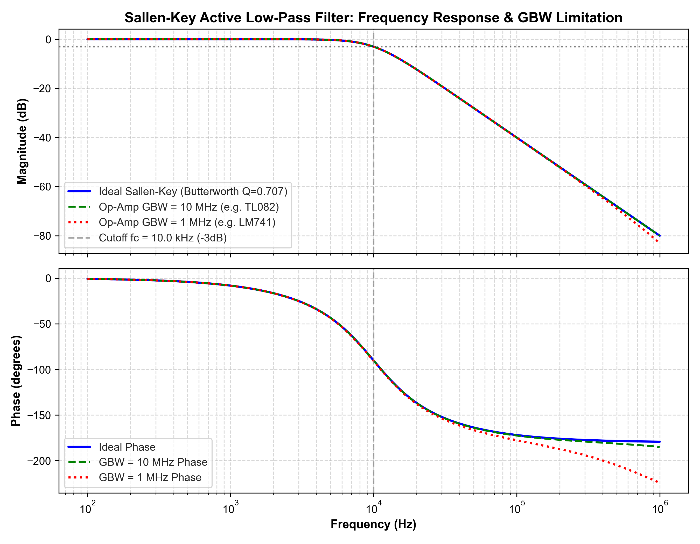
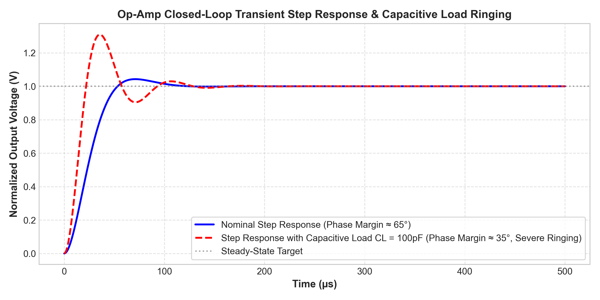

# Sallen-Key Active Filter Design & Op-Amp Stability Analysis

A comprehensive simulation and analysis of second-order active Sallen-Key low-pass and band-pass filters, evaluating op-amp non-idealities, Gain-Bandwidth Product (GBW) limits, and closed-loop phase margin degradation under capacitive loading.

Developed by **Ajit Kumar** (Undergraduate, Electrical & Electronics Engineering, **BIT Mesra**).

---

## 1. Filter Specifications & Transfer Function
A second-order active low-pass Sallen-Key filter was designed with unity gain ($K = 1$), cut-off frequency $f_c = 10\text{ kHz}$, and Butterworth maximally flat response ($Q = 0.707$).

### Biquadratic Transfer Function:
$$H(s) = \frac{\frac{K}{R_1 R_2 C_1 C_2}}{s^2 + s \left[ \frac{1}{R_1 C_1} + \frac{1}{R_2 C_1} + \frac{1-K}{R_2 C_2} \right] + \frac{1}{R_1 R_2 C_1 C_2}}$$

### Component Sizing:
- $R_1 = R_2 = 10\text{ k}\Omega$
- $C_1 = 2.25\text{ nF}$, $C_2 = 1.13\text{ nF}$
- Calculated $f_c \approx 9.98\text{ kHz}$, $Q \approx 0.707$

---

## 2. Gain-Bandwidth Product (GBW) Limitation
Real op-amps introduce high-frequency roll-off due to finite open-loop gain and dominant pole compensation. Comparing a standard op-amp (GBW = 1 MHz) against a high-speed op-amp (GBW = 10 MHz) reveals passband peaking and premature phase lag:



---

## 3. Capacitive Load Driving & Phase Margin Loss
Driving a capacitive load ($C_L = 100\text{ pF}$) creates an additional pole with the op-amp's open-loop output impedance $R_o$, eroding phase margin below $45^\circ$ and causing transient ringing.



---

## How to Run
```bash
python active_filter_opamp.py
```
Or open `sallen_key_filter.cir` in **LTspice** or **NI Multisim** to run AC and transient sweeps.
